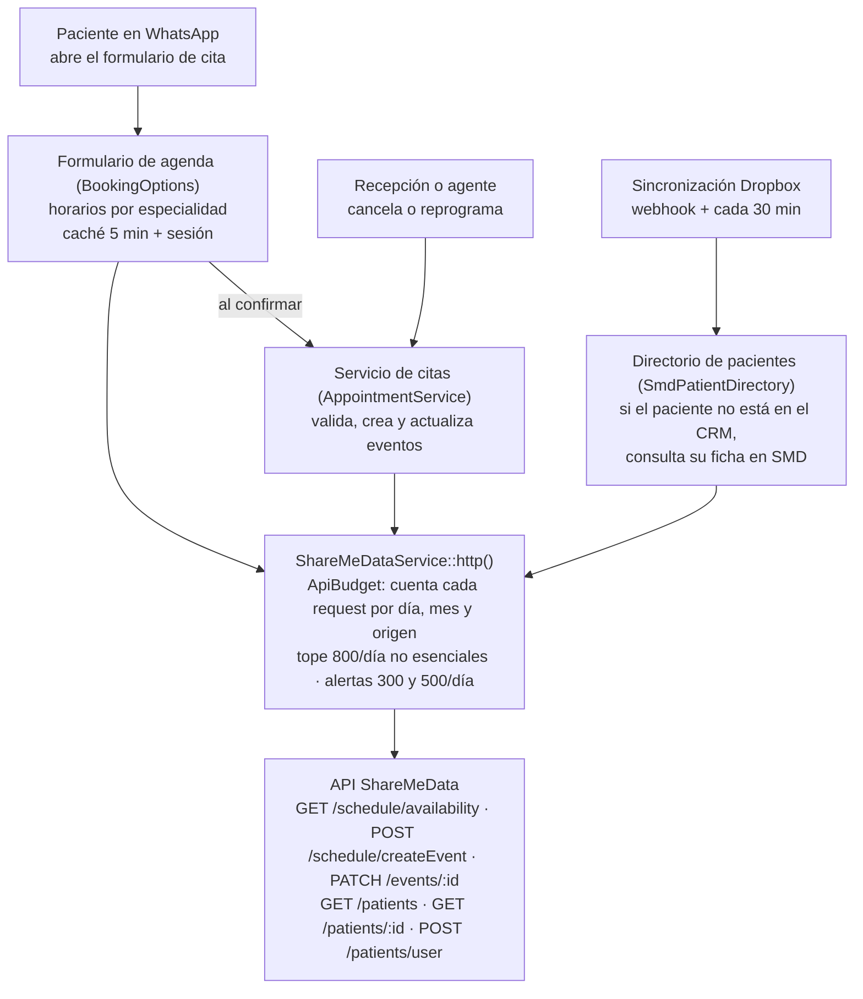

# Integración CRM OdontoKing ↔ ShareMeData: incidente, correcciones y consumo máximo

**Fecha:** 15 de octubre de 2026 · **Autor:** Sofopolis · **Destinatarios:** equipo técnico de shareMEData y OdontoKing

> **Cómo leer este documento.** Cada afirmación sobre el comportamiento del CRM se acompaña del fragmento de código que la implementa o de la prueba automática que la verifica. Los fragmentos son copias del código en producción; las líneas omitidas se marcan con `// …`. Las cifras de consumo salen del medidor del CRM (sección 8) y de los eventos de SMD sincronizados desde Dropbox (sección 6).

## 1. Resumen

Proponemos un **consumo máximo de 8.000 requests a SMD por mes** (80 % de las 10.000 contratadas). Ese máximo alcanza para agendar por WhatsApp hasta una de cada cuatro citas de la clínica.

- **Incidente:** el 12 de octubre un job programado del CRM hizo unas 5.720 requests en 17 horas, consultando horarios cada 10 minutos aunque nadie estuviera agendando.
- **Corrección:** el job se eliminó del código. El CRM ya no consulta SMD de forma periódica: solo lo hace cuando un paciente agenda, cancela o reprograma, o cuando aparece un paciente nuevo en los eventos que SMD exporta a Dropbox.
- **Volumen real de la clínica:** según los eventos de SMD en Dropbox, OdontoKing agenda unas **2.660 citas por mes** (unas 100 por día hábil, con picos de 172) y tiene unos **20 pacientes nuevos por día hábil**.
- **Consumo esperado:** entre 5.600 y 8.200 requests por mes si por WhatsApp se agenda entre el 10 % y el 25 % de esas citas.
- **Controles activos:** medidor de cada request, tope diario de 800 requests no esenciales y alertas por correo a las 300 y 500 requests diarias.
- **Pendiente antes de reactivar:** tope mensual de 8.000 requests (sección 7.3). **Todavía no está implementado.**

## 2. Causa raíz del incidente

El 12 de octubre se puso en producción una **copia local de los horarios libres de cada doctor**. Su objetivo era que el formulario de agendamiento por WhatsApp mostrara los horarios al instante, sin esperar la respuesta de la API. Un job programado mantenía esa copia al día recorriendo cada combinación doctor–especialidad y llamando a `GET /schedule/availability` con un rango de 50 días.

| Parámetro | Valor |
| --- | --- |
| Combinaciones doctor–especialidad por ejecución | 59 (17 doctores) |
| Frecuencia del job | Cada 10 minutos, 24 h |
| Ejecuciones el 12/10 (07:40 → 00:40) | 97 |
| Requests resultantes | 97 × 59 ≈ **5.720** |
| Requests extra por refrescos tras cancelar o reprogramar | ~100 |

El volumen coincide con el reportado por shareMEData (más de 5.700 requests en 17 horas).

**Por qué no se detectó a tiempo:**

1. El CRM no medía cuántas requests hacía a SMD; el consumo solo era visible del lado de shareMEData.
2. No había un límite que detuviera el job.
3. El diseño no calculó el costo del job contra la cuota contratada.
4. Era además ineficiente: `/schedule/availability` filtra por especialidad y devuelve a todos sus doctores en una sola respuesta, así que las 59 requests por ejecución podían haber sido 8.

## 3. Arquitectura de la integración

El CRM llama a SMD desde tres componentes, siempre a través de un único cliente HTTP (`ShareMeDataService`) que cuenta y limita cada request.



**Un único punto de salida.** Todas las llamadas a la API se construyen con este método. Antes de armar el request, `authorize()` lo cuenta o lo bloquea:

```php
// packages/Webkul/Admin/src/Services/ShareMeDataService.php
protected function http(): \Illuminate\Http\Client\PendingRequest
{
    $endpoint = debug_backtrace(DEBUG_BACKTRACE_IGNORE_ARGS, 2)[1]['function'] ?? 'http';
    // Pasado el tope diario, una consulta no esencial lanza QuotaExceeded
    // acá: cada método la atrapa como una falla de SMD y responde vacío.
    app(ApiBudget::class)->authorize($endpoint, ApiBudget::callerOutside(self::class));

    $client = Http::withHeaders([
        'Accept'  => 'application/json',
        'apikey'  => $this->apiKey,
    ]);
    // …
    return $client;
}
```

La única llamada que no pasa por `http()` es la consulta en paralelo de fichas (`getPatientsMany`), que llama a `authorize()` directamente con la cantidad de fichas del lote:

```php
app(ApiBudget::class)->authorize('getPatientsMany', ApiBudget::callerOutside(self::class), count($chunk));
```

## 4. Cambios implementados

**Compromiso sin polling.** El job que mantenía la copia local de horarios fue la única consulta periódica (polling) del CRM contra SMD, y fue eliminado. Sofopolis se compromete a no volver a consultar la API de SMD de forma periódica: toda request nace de una acción concreta.

| # | Cambio | Qué hace | Efecto en el consumo |
| --- | --- | --- | --- |
| 1 | **Se eliminó el job de horarios** | Se borraron del código el job (`RefreshBookingSlots`), su comando (`whatsapp:booking-catalog`) y los disparadores que lo refrescaban. No es un apagado por configuración: no puede reactivarse por error. | Elimina las ~5.700 requests diarias del incidente. |
| 2 | **Tareas programadas bajo control** | Una prueba automática lista las tareas programadas permitidas y falla si se agrega una nueva sin revisar su costo. Solo `smd:sync-dropbox` puede llamar a SMD, y únicamente por pacientes nuevos. | Impide que vuelva a aparecer un polling. |
| 3 | **Horarios bajo demanda, por especialidad** | Se consulta SMD solo cuando el paciente elige una especialidad: 1 request para los próximos 7 días con todos sus doctores. La respuesta se reutiliza 5 minutos y se guarda en la sesión del formulario. "Otra fecha" consulta solo ese día. | 1 request por especialidad elegida (2 si SMD tarda más de 7 s). Elegir doctor, día y hora cuesta 0. |
| 4 | **Sin requests duplicadas** | Si varios pacientes eligen la misma especialidad a la vez, sale un solo request. Si SMD falla, la falla se recuerda 1 minuto y no se reintenta en cada toque. | Evita ráfagas y reintentos en bucle. |
| 5 | **Fichas de pacientes recordadas** | La sincronización de Dropbox busca en SMD solo a los pacientes que no están en el CRM. El resultado (exista o no la ficha) se recuerda 7 días; los errores no se recuerdan y se reintentan en la sincronización siguiente. | Un paciente se consulta una sola vez por semana. Verificado el 14 y 15/10: ninguna consulta repetida. |
| 6 | **Una sola revalidación al confirmar** | El formulario pasa la especialidad elegida y el CRM valida ese horario primero, en lugar de probar las especialidades del doctor una por una. | Confirmar cuesta 3 requests (5 si el paciente es nuevo en SMD), en vez de hasta 3 revalidaciones extra. |
| 7 | **Doble reserva sin consultar** | Al confirmar, el horario se descuenta de la disponibilidad guardada, así otro paciente no lo ve libre. | 0 requests extra. |
| 8 | **Medidor, tope y alertas** | Cada request se cuenta antes de salir. Tope de 800 requests no esenciales por día y alertas por correo a las 300 y 500 diarias (detalle en la sección 8). | Hace visible el consumo y frena cualquier desvío el mismo día. |

Cada cambio está cubierto por pruebas automáticas: `SmdApiBudgetTest`, `SmdUsageAlertTest`, `SmdPatientDirectoryCacheTest`, `SmdConfirmCostTest` y `FlowV4UxTest`.

## 5. Costo en requests por operación

Una cita agendada por WhatsApp cuesta **entre 4 y 8 requests** (6 en promedio). Moverse entre pantallas del formulario no cuesta ninguna. Las cifras se midieron con el medidor del CRM contra el entorno de pruebas de SMD el 13 de octubre de 2026, y se ajustaron con el cambio 6 de la sección 4.

| Operación | Endpoints | Requests |
| --- | --- | --- |
| Ver horarios de una especialidad | `GET /schedule/availability` (7 días) | 1 (2 con "General", que agrupa dos especialidades; +1 si SMD tarda más de 7 s) |
| Elegir doctor, día y hora | — | 0 |
| "Otra fecha" | `GET /schedule/availability` (1 día) | 1 |
| Identificar al paciente por cédula (primera vez) | `GET /patients` | 1 |
| Confirmar cita, paciente ya registrado en SMD | `GET /schedule/availability` + `POST /schedule/createEvent` + `PATCH /events/:id` | 3 |
| Confirmar cita, paciente nuevo en SMD | Lo anterior + `GET /patients` (teléfono o cédula) + `POST /patients/user` | 5 |
| Cancelar | `PATCH /events/:id` | 1 |
| Reprogramar | `GET /schedule/availability` + `PATCH /events/:id` | 2 |
| Paciente nuevo visto en Dropbox | `GET /patients/:id` + `GET /patients` por nombre | 1–3, una vez cada 7 días |

- **Caso más barato (4):** paciente ya registrado que elige una especialidad específica.
- **Caso más caro (8):** paciente nuevo que elige "General" e ingresa su cédula por primera vez.
- **Citas agendadas directamente en SMD:** no generan requests del CRM, salvo la búsqueda de ficha si el paciente es nuevo.

## 6. Volumen real de citas (eventos de SMD en Dropbox)

OdontoKing agendó **2.662 citas en septiembre de 2026**: unas 100 por día hábil, con un máximo de 172 en un día. Los datos salen de los eventos con paciente que SMD exporta a Dropbox y que el CRM sincronizó hasta el 12 de octubre: 11.310 eventos, de los que se excluyen los 1.495 bloqueos "Ocupado" sin paciente.

| Período | Citas agendadas | Pacientes nuevos |
| --- | --- | --- |
| Agosto 2026 | 1.892 | — |
| Septiembre 2026 | 2.662 | 524 |
| 1 al 12 de octubre 2026 | 1.185 | — |

| Día de la semana | Citas por día (promedio) | Máximo observado |
| --- | --- | --- |
| Lunes | 132 | 172 |
| Martes | 109 | 144 |
| Miércoles | 107 | 149 |
| Jueves | 84 | 140 |
| Viernes | 83 | 137 |
| Sábado | 39 | 56 |
| Domingo | 4 | 9 |

- **Pacientes nuevos:** 20 por día hábil en promedio, 33 en el 90 % de los días y 42 como máximo (septiembre al 12 de octubre). Un paciente nuevo es uno cuyo id de SMD aparece por primera vez en los eventos. Son los que generan búsquedas de ficha.
- **Fecha de cada cita:** se toma la de creación del evento en SMD (`created_at`, hora de Bolivia), no la de atención.

## 7. Consumo máximo

### 7.1 Escenarios mensuales

Con el volumen de septiembre, la cuota de 10.000 alcanza para agendar por WhatsApp hasta el **36 % de las citas** de la clínica. Proponemos comprometer un **máximo de 8.000 requests por mes**, que cubre hasta el 25 %.

| Requests a SMD por mes | 10 % por WhatsApp | 25 % por WhatsApp | 36 % por WhatsApp | 100 % por WhatsApp (teórico) |
| --- | --- | --- | --- | --- |
| Citas por WhatsApp (de 2.662) | 266 | 666 | 958 | 2.662 |
| Agendar, cancelar y reprogramar (6,45 por cita) | 1.717 | 4.293 | 6.180 | 17.170 |
| Pacientes nuevos en Dropbox | 2.860 | 2.860 | 2.860 | 2.860 |
| Reserva para días pico | 1.000 | 1.000 | 1.000 | 1.000 |
| **Total** | **5.577** | **8.153** | **10.040** | **21.030** |
| % de la cuota | 56 % | 82 % | 100 % | 210 % |

**Cómo se calculó:**

- **Por cita de WhatsApp:** 6 requests para agendar (promedio de la sección 5), más 0,45 por cancelaciones (1 request, 15 % de las citas) y reprogramaciones (2 requests, 15 % de las citas).
- **Pacientes nuevos en Dropbox:** 110 requests por día hábil × 26 días, medido el 14 de octubre de 2026. Es un valor alto a propósito: se midió contra el entorno de pruebas de SMD, donde las fichas de producción no existen y el CRM las busca también por nombre. En producción la ficha se encuentra en la primera consulta; con 20 pacientes nuevos por día el valor esperado es de unas 1.600 por mes.
- **Reserva para picos:** cubre días con cargas masivas de pacientes.

### 7.2 Día de mayor consumo

Un lunes pico (172 citas) con el 25 % por WhatsApp suma 43 citas × 6,45 + 42 pacientes nuevos × 3 ≈ **400 requests**. Queda por debajo del tope diario de 800 y dispara la alerta amarilla de las 300 (sección 8.2).

### 7.3 Tope mensual (pendiente de implementar)

**Este control todavía no existe en el código.** Proponemos implementarlo antes de reactivar el acceso de producción.

Al llegar a 8.000 requests en el mes, el CRM dejaría de consultar disponibilidad para el formulario de WhatsApp y derivaría a esos pacientes a recepción. Seguirían solo las operaciones esenciales: actualizar o cancelar citas ya creadas y buscar pacientes nuevos de Dropbox (unas 110 por día). Así el mes no podría cerrar por encima de unas 9.000–9.500 requests, aunque la adopción de WhatsApp supere lo previsto.

## 8. Controles

### 8.1 Medidor y tope diario

Cada request se cuenta en Redis **antes de enviarse**, por día, mes y origen. Los contadores se guardan 45 días. Se cuentan también las requests que fallan, porque SMD las cobra igual.

```php
// packages/Webkul/Admin/src/Services/Smd/ApiBudget.php
public function authorize(string $endpoint, string $source, int $count = 1): void
{
    $cap = (int) config('smd.api_budget.daily_cap', 800);
    $day = now(config('app.timezone'))->toDateString();

    if ($cap > 0 && $this->day($day) + $count > $cap) {
        if (! $this->isEssential($endpoint, $source)) {
            // …
            throw new QuotaExceeded("Tope diario de consultas a SMD alcanzado ({$cap}): {$source} → {$endpoint}");
        }
        // …
    }

    $this->record($endpoint, $source, $count);
    // … alerta mensual en el log al pasar las 8.000
}
```

Las operaciones esenciales pasan aunque se haya llegado al tope:

```php
// config/smd.php
'essential_endpoints' => ['createEvent', 'updateEvent'],
'essential_sources'   => ['AppointmentService::', 'SmdAppointmentPush::', 'SmdPatientDirectory::'],
```

El consumo se consulta con `php artisan smd:usage [--days=N]`, que muestra las requests por día, el total del mes y los orígenes.

### 8.2 Alertas diarias por correo (activas desde el 15/10)

| Nivel | Cuándo se dispara | Destinatarios |
| --- | --- | --- |
| Aviso (amarillo) | Al llegar a **300** requests en el día | Personal de OdontoKing y Sofopolis |
| Peligro (rojo) | Al llegar a **500** requests en el día | Personal de OdontoKing y Sofopolis |

```php
// packages/Webkul/Admin/src/Services/Smd/ApiBudget.php (se ejecuta después de contar cada request)
protected function alertIfNeeded(string $day): void
{
    $config = (array) config('smd.api_budget.alerts', []);
    $today = $this->day($day);

    foreach (['danger' => 'danger_daily', 'warning' => 'warning_daily'] as $level => $key) {
        $threshold = (int) ($config[$key] ?? 0);

        if ($threshold <= 0 || $today < $threshold) {
            continue;
        }

        if (! Cache::add("smd:usage:alert:{$day}:{$level}", true, now()->addDays(2))) {
            return;
        }
        // …
        Mail::to($emails)->queue(new SmdUsageAlert($level, $day, $today, $threshold, $this->month(), $this->bySource($day)));
        // …
        return;
    }
}
```

- **Frecuencia:** cada alerta sale una sola vez por día. Si el consumo salta de golpe a más de 500, sale solo la roja.
- **Contenido del correo:** el total del día, el acumulado del mes y qué componente generó las requests.
- **Configuración:** umbrales y destinatarios en `SMD_ALERT_WARNING_DAILY`, `SMD_ALERT_DANGER_DAILY` y `SMD_ALERT_EMAILS`.
- **Referencia:** el consumo normal medido es de unas 110 requests por día.

### 8.3 Resumen de controles

| Control | Estado | Verificado por |
| --- | --- | --- |
| Medidor de cada request (incluidas las fallidas) | Activo | `SmdApiBudgetTest` |
| Tope diario de 800 requests no esenciales | Activo | `SmdApiBudgetTest` |
| Alerta mensual en el log a las 8.000 | Activa | `SmdApiBudgetTest` |
| Alertas por correo a las 300 y 500 diarias | Activas | `SmdUsageAlertTest` |
| Tareas programadas revisadas, sin polling a SMD | Activo | `SmdApiBudgetTest` |
| Caché de fichas de 7 días, sin guardar errores | Activo | `SmdPatientDirectoryCacheTest` |
| 1 revalidación al confirmar | Activo | `SmdConfirmCostTest` |
| Jobs del formulario con un solo intento (`$tries = 1`) | Activo | Código de los jobs |
| Tope mensual de 8.000 | **Pendiente** | — |

## 9. Propuesta de reactivación

1. OdontoKing aprueba el máximo de 8.000 requests por mes.
2. Sofopolis implementa el tope mensual de la sección 7.3 y lo confirma con sus pruebas.
3. shareMEData reactiva las credenciales de producción.
4. Durante las dos primeras semanas, Sofopolis envía a shareMEData y OdontoKing un reporte semanal de requests por día y por endpoint (salida de `smd:usage`). Después, el reporte pasa a ser mensual.

**Preguntas para shareMEData:**

- ¿Las requests con error (4xx, 5xx, timeouts) cuentan contra la cuota? Hoy el CRM las cuenta, de forma conservadora.
- ¿Cuál es el costo por request por encima de las 10.000 mensuales?
- ¿Existe un webhook o un endpoint de cambios de agenda que evite consultar disponibilidad?
